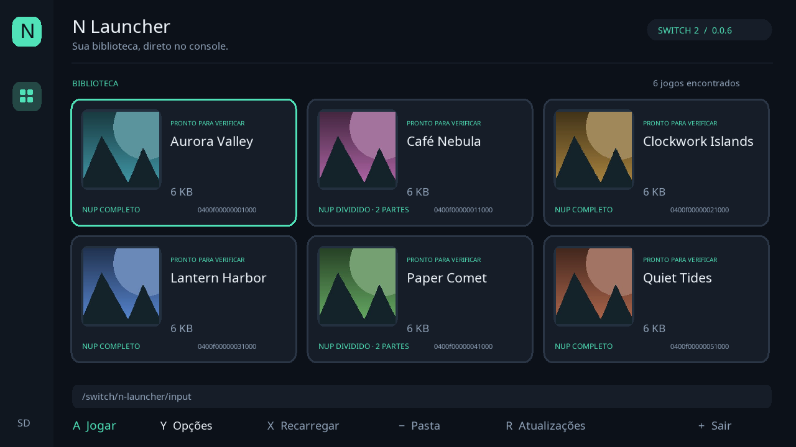

# N Launcher

Homebrew de Switch 2 para preparar e abrir backups NUP diretamente no console, sem compilar um port por jogo no PC. Aceita **NUP completo** e **pasta `.nup` com partes `00`, `01`, …** pelo mesmo seletor.

**Pokopia splitado foi validado no console com imagem, áudio, controles, salvar e carregar funcionando.** A versão 0.0.8 mantém o alocador da interface que resolveu o fechamento observado na preparação e inclui perfis por jogo, atualização pelo console e a pasta `n-launcher`. Os recursos novos têm testes locais e de build; compatibilidade de outros jogos e validação do atualizador no hardware permanecem específicas de cada teste.



*Prévia do renderer com biblioteca sintética; não contém dados de jogos comerciais.*

## Instalar ou atualizar

Baixe o ZIP da [release mais recente](https://github.com/davidkalil10/n-launcher/releases/latest) e extraia no SD. O aplicativo fica em **`/switch/n-launcher/n-launcher.nro`**. Abra **N Launcher**, sem “Diagnostico”, pelo hbmenu com kaiHEN ativo. Trocar o NRO não exige reiniciar ou reativar kaiHEN.

Os dados de `/switch/nx2-link/` são movidos para `n-launcher` por renomeação, sem copiar os gigabytes de cache. Se preferir, renomeie a pasta manualmente antes de extrair o ZIP. Configurações, cache e saves existentes são preservados; dados conflitantes nas duas pastas não são sobrescritos. Depois da migração, utilize a nova versão do aplicativo.

Esta primeira instalação com atualizador é manual. Nas próximas versões, pressione **R — Atualizações**: o aplicativo consulta o GitHub, mostra a versão disponível e permite baixar e instalar. O NRO é conferido antes da troca; a cópia anterior permanece até a nova versão iniciar e confirmar a atualização. [Funcionamento e recuperação](docs/UPDATES.md).

## Usar

- **− Pasta:** escolha onde estão seus NUPs. A seleção fica salva; não precisa mover os jogos.
- **Direcional:** navegue pela biblioteca.
- **A Jogar:** verifica/prepara o necessário e inicia o carregador genérico.
- **Y Opções:** memória por jogo, preparação sem executar, verificação e registros.
- **X Recarregar:** atualiza a lista da biblioteca.
- **R Atualizações:** consulta e instala versões públicas do N Launcher.
- **+ Sair:** volta ao hbmenu.

O arquivo principal inclui o carregador. Não é necessário instalar Python, compilador ou DLLs no console. O aplicativo utiliza a sessão kaiHEN existente; não instala títulos no sistema nem altera saves nativos.

NUPs autocontidos marcados como atualização também podem ser preparados, seguindo o comportamento do runtime. Um pacote de atualização incompleto continua precisando dos arquivos ausentes; o launcher não os cria.

## Memória por jogo

Em **Y → Memória por jogo**, ajuste a memória informada ao jogo e a reserva inicial do carregador. Use esquerda/direita, **A** para salvar, **X** para restaurar **Automático** e **B** para cancelar. O perfil é identificado pelo ID do título e mantém os demais campos de `game.cfg`, incluindo o slot de save.

O padrão continua Automático, preservando o comportamento validado do Pokopia. Reservar mais para o carregador reduz o espaço disponível ao jogo; valores altos de memória do jogo podem impedir sua abertura. Esses perfis são usados na execução e não fazem o cache descomprimir mais rápido. A preparação mantém buffers limitados. [Detalhes e limites](docs/MEMORY_PROFILES.md).

## Dados e espaço no SD

NUPs e partes são somente leitura. Arquivos comprimidos de RomFS maiores que 64 MiB são preparados para um cache no SD em partes de até 1 GiB, com tamanho e SHA-256 conferidos. A primeira preparação pode levar vários minutos e exigir vários gigabytes extras; uma atualização não invalida esse cache quando o conteúdo e o formato permanecem iguais.

```text
/switch/n-launcher/
  n-launcher.nro       aplicativo
  menu.cfg            pasta da biblioteca
  cache/              metadados e ícones
  content/            dados expandidos e verificados
  <ID>/game.cfg       perfil do título
  <ID>/save/          saves do runtime
  logs/               registros de preparação e abertura
  .runtime/           carregador incorporado
```

Saves do runtime são separados dos saves do console e de outros projetos. Slots adicionais continuam sob a pasta do título. Cache publicado é reutilizado após conferência de marcador e tamanhos; não há rehash integral automático a cada abertura. [Formato e recuperação](docs/CACHE.md).

## Build e releases automáticas

O GitHub Actions testa fixtures sintéticas, gera os dois NROs com o SDK público fixado e verifica startup OUN0 plataforma 2/versão 1, assets e bibliotecas. Cada push gera uma build de teste em rascunho. Tags `v<versão>` ou a opção **publish_release** do workflow na main publicam NRO, ZIP, checksums e o manifesto consumido pelo atualizador, somente após os testes.

Para desenvolvimento local no Windows:

```powershell
python -m pip install -r requirements-build.txt
./scripts/test-host.ps1 -Compiler <g++.exe>
./scripts/test-launcher.ps1 -Compiler <g++.exe>
./scripts/build-switch2.ps1 -SdkRoot <devkitpro> -SupportRoot <DLLs-do-toolchain>
python tools/package_release.py
```

Nenhum jogo, chave, save ou log do SD é enviado ao CI. [Publicar uma próxima versão](docs/UPDATES.md).

## Documentação

- [Atualização, releases e recuperação](docs/UPDATES.md)
- [Perfis de memória](docs/MEMORY_PROFILES.md)
- [Arquitetura](docs/ARCHITECTURE.md) e [cache](docs/CACHE.md)
- [Interface](docs/INTERFACE.md), [roadmap](docs/ROADMAP.md) e [validação](docs/VALIDATION.md)
- [Decisões](docs/DECISIONS.md), [aprendizados](docs/LEARNINGS.md) e [continuidade](docs/HANDOFF.md)

## Créditos e licenças

Mantido por **David Kalil Braga (@davidkalil10)**. [Apoiar o desenvolvimento](https://ko-fi.com/davidkalil10).

- [Olmectron/nx2-flow](https://github.com/Olmectron/nx2-flow): loader genérico 0.1.3, MIT; componentes do menu 0.2.2, GPL-2.0-or-later. Revisão e hashes em `config/flow.json`; adaptações geradas separadamente.
- [nx2-relink](https://github.com/Olmectron/nx2-relink) e [nx-relink](https://github.com/Olmectron/nx-relink): runtime e relinker MIT; referência 0.1.12 com a correção de áudio preservada em `config/upstream.json`.
- [Toronja](https://github.com/Olmectron/toronja), Azahar Emulator Project e PalindromicBreadLoaf: origem dos componentes gráficos; avisos GPL preservados.
- [a55uka/nup](https://github.com/a55uka/nup): formato NUP.
- [kaiHEN](https://github.com/ouncebrew/kaihen), [ounce-devkit](https://github.com/ouncebrew/ounce-devkit), [libounce](https://github.com/ouncebrew/libounce) e devkitPro: ambiente, carregador, SDK, alocadores e ferramentas. O HTTPS usa o serviço TLS nativo do console.
- [Zstandard](https://github.com/facebook/zstd): decoder 1.5.7, BSD-3-Clause.
- [Noto Sans](https://github.com/google/fonts/tree/main/ofl/notosans): fonte, SIL Open Font License 1.1. Pillow é usado somente na build.
- Eden-NX2 e ports anteriores de David: referências de toolchain e ciclo de vida; nenhum código de emulação do Eden foi copiado.

O núcleo próprio e o runtime MIT mantêm suas licenças permissivas. A aplicação gráfica combinada é GPL-2.0-or-later, com fontes correspondentes neste repositório. Avisos completos estão em `third_party/` e acompanham o ZIP. Use backups próprios; a validação de um título não garante compatibilidade geral.
