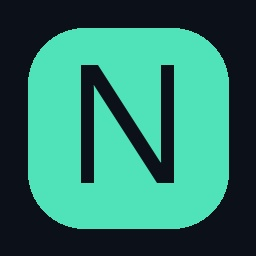

# N Launcher

[](https://github.com/davidkalil10/n-launcher/actions/workflows/build.yml)
[](https://ko-fi.com/davidkalil10)

Nintendo Switch 2 homebrew for preparing and launching NUP backups directly on the console, without building a separate NRO for each game on a PC. The same browser accepts **single-file NUPs** and **split `.nup` folders containing `00`, `01`, …**.



## Current status

- **In-app updates:** automatic startup checks and in-console installation through `0.0.17` have been validated. Game data, memory profiles and saves are preserved.
- **Experimental status:** N Launcher remains experimental. Compatibility and validation results apply to the individual titles, host titles and features tested.

## Confirmed compatibility

| Title | Format | Status | Version | Notes |
|---|---|---|---|---|
| **Pokopia** | Split NUP | Working | 0.0.16 | Graphics, audio, controls, saving and loading validated on console (no glitches observed). |
| **Orbitals** | NUP | Working | 0.0.16 | Launching, gameplay, saving and loading validated on console (no glitches observed); self-contained update package. |
| **The Adventures of Elliot: The Millennium Tales** | Split NUP | Working | 0.0.16 | Full game launching, gameplay, saving and loading validated on console (no glitches observed). |
| **The Legend of Zelda: Ocarina of Time** | Split NUP | Working | 0.0.16 | Opening cutscene, loading screens, gameplay, audio, saving and loading validated on console (no glitches observed; ZBIC NSO, Split Fiction host, Automatic memory). |
| **Donkey Kong Bananza** | Split NUP | Working | 0.0.17 | Validated on console after 0-byte NUP entry fix. |
| **Fast Fusion** | NUP | Working | 0.0.17 | Validated on console. |
| **Super Mario Bros. Wonder** | NUP | Working | 0.0.17 | Validated on console. |
| **Mario Kart World** | Split NUP | Host-limited | 0.0.17 | Initializes CPU, audio, shaders and NVN buffers, but requires a host title with at least **192 MB Remote Memory** and **64 MB System Resource** (aborts on 48–64 MB hosts). |

## Installation and updates

Download the ZIP from the [latest release](https://github.com/davidkalil10/n-launcher/releases/latest) and extract it to your SD card. The application is installed at **`/switch/n-launcher/n-launcher.nro`**. Open **N Launcher** through hbmenu with kaiHEN active. Replacing the NRO does not require rebooting or reactivating kaiHEN.

New installations are manual. **Versions 0.0.8 and earlier need a manual upgrade to 0.0.9 or newer** because their TLS connection setup can fail before downloading. From version 0.0.11, a startup check looks for new releases automatically. Review and confirm the available version before anything is downloaded or installed. Use **L — App settings** to disable startup checks, or **R — Updates** to check manually. Connection errors return to the library and do not prevent game operations. The downloaded NRO is verified before replacement, and the previous copy is kept until the new version starts and confirms the update. See [updates and recovery](docs/UPDATES.md).

Data from the old `/switch/nx2-link/` directory is migrated to `n-launcher` by renaming, without copying gigabytes of cache. You can also rename the old directory manually before extracting the ZIP. Existing settings, cache and saves are preserved. Conflicting entries in both directories are not overwritten; resolve the conflict before continuing. Use the new application after migration rather than an older diagnostic build.

## Controls

The application interface supports **Português** and **English**, switchable anytime under **L — App settings** (`language=pt` / `language=en` in `menu.cfg`).

| Button | Action |
|---|---|
| **− — Folder** | Choose the folder containing your NUPs. The selection is saved; games do not need to be moved. |
| **D-pad** | Navigate the library. |
| **A — Play** | Verify and prepare the required data, then start the generic loader. |
| **Y — Options** | Open per-game memory settings, prepare without launching, inspect a NUP or view logs. |
| **X — Refresh** | Refresh the library. |
| **L — App settings** | Enable or disable checking for updates on startup. |
| **R — Updates** | Check for and install public N Launcher releases. |
| **+ — Exit** | Exit to hbmenu. |

The main NRO includes the loader. No Python installation, compiler or DLLs are needed on the console. N Launcher uses the existing kaiHEN session; it does not install system titles or modify native console saves.

Self-contained NUPs marked as updates can also be prepared, following the runtime's behavior. An incomplete update still requires its missing files; N Launcher does not supply them.

The preparer supports LZ4 and ZBIC-compressed NSO segments. ZBIC uses the pinned runtime transcoder, followed by Zstandard decoding and the existing segment hash checks, validated on the console with Zelda: Ocarina of Time (six-part split NUP).

## Per-game memory settings

Open **Y → Per-game memory** to adjust the memory reported to the game and the loader's initial reservation. Use left/right to change values, **A** to save, **X** to restore **Automatic** and **B** to cancel. Profiles are keyed by title ID and preserve the other fields in `game.cfg`, including the save slot.

The default remains **Automatic**, preserving the configuration validated with Pokopia. Reserving more memory for the loader leaves less for the game, while reporting too much memory to a game may prevent it from starting. These settings apply to execution; they do not speed up cache decompression. Preparation uses bounded buffers. See [memory settings and limits](docs/MEMORY_PROFILES.md).

## SD card data and storage

NUPs and their split parts are read-only inputs. Compressed RomFS files larger than 64 MiB are prepared into an SD card cache in chunks of up to 1 GiB, with size and SHA-256 checks. First-time preparation can take several minutes and require several additional gigabytes. Updating the application does not invalidate the cache when its content and format remain unchanged.

```text
/switch/n-launcher/
  n-launcher.nro      application
  menu.cfg           library folder setting
  cache/             metadata and icons
  content/           verified, decompressed data
  <ID>/game.cfg      per-title settings
  <ID>/save/         runtime saves
  logs/              launch logs and separate updater logs
  .runtime/          embedded loader installation
```

Runtime saves are separate from native console saves and saves used by other projects. Additional save slots remain under the title's directory. Published cache entries are reused after checking their completion marker and chunk sizes; their full contents are not rehashed automatically on every launch. See [cache format and recovery](docs/CACHE.md).

## Building and automated releases

[GitHub Actions](https://github.com/davidkalil10/n-launcher/actions/workflows/build.yml) tests synthetic fixtures, builds both NROs using the pinned public SDK, and verifies the OUN0 platform 2/version 1 startup, assets and linked libraries. Code pushes generate draft test builds. Matching `v<version>` tags, or the **publish_release** workflow option on main, publish the NRO, SD ZIP, checksums and updater manifest after the checks pass.

For local Windows development:

```powershell
python -m pip install -r requirements-build.txt
./scripts/test-host.ps1 -Compiler <g++.exe>
./scripts/test-launcher.ps1 -Compiler <g++.exe>
./scripts/build-switch2.ps1 -SdkRoot <devkitpro> -SupportRoot <toolchain-DLL-directory>
python tools/package_release.py
```

No games, keys, saves or SD card logs are uploaded to CI. See [publishing a release](docs/UPDATES.md).

## Documentation

The detailed engineering notes are currently in Portuguese.

- [Updates, releases and recovery](docs/UPDATES.md)
- [Memory profiles](docs/MEMORY_PROFILES.md)
- [Architecture](docs/ARCHITECTURE.md) and [cache](docs/CACHE.md)
- [Interface](docs/INTERFACE.md), [roadmap](docs/ROADMAP.md) and [validation](docs/VALIDATION.md)
- [Decisions](docs/DECISIONS.md), [lessons learned](docs/LEARNINGS.md) and [handoff notes](docs/HANDOFF.md)

## Support

If you find **N Launcher** useful, consider buying me a coffee to support continued development and maintenance of this project and my Nintendo Switch 2 homebrew ports.

[](https://ko-fi.com/davidkalil10)

**[Support David Kalil Braga on Ko-fi](https://ko-fi.com/davidkalil10)**

## Credits and licenses

Maintained by **David Kalil Braga ([@davidkalil10](https://github.com/davidkalil10))**.

- [Olmectron/nx2-flow](https://github.com/Olmectron/nx2-flow): generic loader 0.1.7 (from release 0.2.6) and ZBIC transcoder, MIT; menu components 0.2.2, GPL-2.0-or-later. Revision and hashes are pinned in `config/flow.json`; adaptations are generated separately.
- [ptichalouf / nx2-flow PR #44](https://github.com/Olmectron/nx2-flow/pull/44): bounded lock backoff that lets lower-priority threads finish file reads/decompression; MIT helper pinned in `config/runtime-lock-fix.json`.
- [nx2-relink](https://github.com/Olmectron/nx2-relink) and [nx-relink](https://github.com/Olmectron/nx-relink): MIT runtime and relinker; reference version 0.1.12, including the audio fix, is pinned in `config/upstream.json`.
- [Toronja](https://github.com/Olmectron/toronja), Azahar Emulator Project and PalindromicBreadLoaf: origins of the graphics components; GPL notices are preserved.
- [a55uka/nup](https://github.com/a55uka/nup): NUP format.
- [kaiHEN](https://github.com/ouncebrew/kaihen), [ounce-devkit](https://github.com/ouncebrew/ounce-devkit), [libounce](https://github.com/ouncebrew/libounce) and devkitPro: homebrew environment, loader, SDK, allocators and tools. HTTPS uses the console's native TLS service.
- [Zstandard](https://github.com/facebook/zstd): decoder 1.5.7, BSD-3-Clause.
- [Noto Sans](https://github.com/google/fonts/tree/main/ofl/notosans): font, SIL Open Font License 1.1. Pillow is a build-only dependency.
- Eden-NX2 and David's earlier ports: toolchain and lifecycle references; no Eden emulation code was copied.

The original core and MIT runtime retain their permissive licenses. The combined graphical application is GPL-2.0-or-later, with corresponding source in this repository. Full notices are preserved under `third_party/` and included in the release ZIP. Use your own backups; validation of one title does not establish general compatibility.
