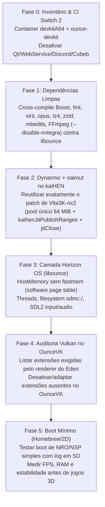

# A Bíblia do Port de Homebrews para Nintendo Switch 2

> **Autor / Mantenedor:** David Kalil Braga ([@davidkalil10](https://github.com/davidkalil10))  
> **Base prática validada em hardware real (Switch 2):** `green-nx_switch-2`, `Switch2NOW`, `switch2iptv`, `BattleShip-remix-NS2`, `StremNX2`, `netsurf-switch2`, `super-moonlight-nx2`, `GMCA_NX2`, `Vita3K-nx2` e `ppsspp-nx2`.  
> **Objetivo:** Manual técnico definitivo para evitar erros repetidos em novos ports para Switch 2 (`ounce-devkit` / `libounce` + `OunceVK` + `kaiHEN`) e servir de base sólida para projetos maiores como o **Eden (`eden-emu/eden`)**.

---

## 1. Triagem Rápida: O Projeto É Portável Hoje no Switch 2?

Antes de clonar e compilar, aplique esta regra de ouro:

| Tipo de Projeto | Viabilidade Atual no Switch 2 | Exemplos |
|---|---|---|
| **Apps/jogos SDL2/SDL3/GL/Vulkan open-source (sem JIT)** | **Alta (rápido)** | `GMCA_NX2`, `super-moonlight-nx2`, `BattleShip-remix-NS2`, `StremNX2` |
| **Emuladores C++ open-source com port prévio de Switch 1** | **Alta (cirúrgico)** | `Vita3K-nx2` (`Dynarmic`), `ppsspp-nx2` (`Arm64IRJit`), `melonDS`, `Flycast`, `DuckStation`, `Dolphin` |
| **Emuladores C++ open-source SEM port prévio de Switch** | **Possível, esforço grande (fases)** | `Eden` (Switch 1), `Azahar/Citra` (3DS), `PCSX2` ARM64, `bloodborne-runtime` |
| **Wrappers de `.so` fechado de Android (`so_loader`)** | **Bloqueado hoje** | `NetherSX2_nx`, `DrasticDS_nx` (exigem `svcMapProcessCodeMemory` + `svcControlCodeMemory` + JIT fechado) |
| **Rewriters que exigem `mmap` fixo + `SIGSEGV` Linux/Android** | **Bloqueado hoje** | `peanuts-native` (exige `mmap`/`mprotect`/`SIGSEGV` + Android JNI) |

---

## 2. Toolchain & Receita Padrão de GitHub Actions (CI)

Use **sempre** esta base comprovada em container Linux:

- **Container Docker:** `devkitpro/devkita64:20260219`
- **SDK Switch 2:** `ouncebrew/ounce-devkit` (commit `0f38ba80d7ee768c5749278f127749d14ece2036`, release `20261115b`)
- **Toolchain CMake:** `$DEVKITPRO/libounce/cmake/Switch2.cmake`
- **Makefiles:** `include $(DEVKITPRO)/libounce/switch2_rules` e `-specs=$(DEVKITPRO)/libounce/switch.specs`
- **Flags de compilação obrigatórias:**
  ```text
  -mcpu=cortex-a78c+crypto -mtp=soft -ftls-model=local-exec -D__SWITCH__ -D__SWITCH2__
  ```
- **Ordem estrita de diretórios (NUNCA incluir `/libnx/`):**
  1. `$DEVKITPRO/portlibs/switch2/{include,lib}` (`OunceVK`, `libkaihen`)
  2. `$DEVKITPRO/libounce/{include,lib}` (`libounce` / `libnx.a` de Switch 2)
  3. `$DEVKITPRO/portlibs/switch/{include,lib}` (portlibs genéricos puros: `zlib`, `libpng`, `curl`, `mbedtls`, `freetype`, `harfbuzz`, `fribidi`, etc.)
- **LTO & PGO:** Desative `LTO` (`OFF`) e `PGO` (`OFF`) no Switch 2 — evita bugs de linker com objetos `.o` do `kaiHEN` e reduz drasticamente o tempo de CI.
- **Armadilha de Windows -> Linux CI:** Cuidado com maiúsculas/minúsculas em caminhos (`Tools/` vs `tools/`). No Windows funciona; no Linux CI dá `FileNotFoundError`.
- **Workflows do upstream:** Ao forkar projetos multiplataforma (como PPSSPP), remova os `.github/workflows/*.yml` das outras plataformas para não disparar dezenas de jobs inúteis a cada push.

---

## 3. Portão de Verificação Obrigatório (`verify_switch2_package.py`)

Todo build de Switch 2 deve emitir link map (`-Wl,-Map=<target>-switch2.map`) e passar por `verify_switch2_package.py`:

1. **Header `OUN0` (`platform=2, version=1`)** logo após `MOD0` (garante startup `libounce` sem aviso no `ounce-hbmenu`).
2. **Container `ASET` válido:** ícone JPEG (`FF D8 FF`) + `NACP` de exatamente `0x4000` bytes.
3. **Auditoria do `.map` — Bibliotecas PROIBIDAS (qualquer uma quebra no Switch 2):**
   - `/libnx/`
   - `/portlibs/switch/lib/libEGL.a`, `libGL.a`, `libGLESv2.a`, `libglapi.a`, `libvulkan.a`, `libdrm_nouveau.a`
   - `/portlibs/switch/lib/libav*`, `libsw*` (FFmpeg de Switch 1 puxa `nvtegra`!)
   - `libdeko3d`, `hwcontext_nvtegra`, `nvtegra.o`
4. **Auditoria do `.map` — Bibliotecas OBRIGATÓRIAS:**
   - `/libounce/lib/` e `/portlibs/switch2/lib/`
   - `__nx_jit_map_code` (em targets com JIT `kaiHEN`; usar `--no-jit-check` em launchers externos sem JIT).

> [!WARNING]
> **Armadilha clássica de linker (`kaihen-jit.o`):** Em builds CMake usando `Switch2.cmake` / `libounce/switch.specs`, o `kaihen-jit.o` **já é injetado automaticamente**. Se você também adicionar `kaihen-jit.o` manualmente em `target_link_libraries` ou `target_link_options`, o `ld` falha com `multiple definition of __nx_jit_map_code`. Basta linkar `-lkaihen -lnx`.

---

## 4. Gráficos no Switch 2 (`OunceVK` Vulkan 1.4, Zink e LSFG 2x)

Lições críticas validadas em `Vita3K-nx2` e `ppsspp-nx2`:

1. **`libouncevk-gl.a` vs. `libouncevk.a`:**
   - Quando o projeto usa **apenas Vulkan**: linke via `vulkan.pc` (`libouncevk.a`).
   - Quando o projeto usa **OpenGL/EGL (`OpenGL::GL`) E Vulkan (`Vulkan::Vulkan`) juntos** (ex.: PPSSPP): `OpenGL::GL` linka **`libouncevk-gl.a`**, que **já embute todos os símbolos `vk*`** junto com EGL/Zink. Linkar `libouncevk.a` junto gera centenas de `multiple definition of vk*`! Solução: defina `Vulkan::Vulkan` apontando para `OpenGL::GL`.
2. **Entry point Vulkan:**
   - Switch 1 (Mesa antigo): `vk_icdGetInstanceProcAddr`
   - Switch 2 (`OunceVK`): **`vkGetInstanceProcAddr`** padrão!
3. **OpenGL usa Zink, nunca Nouveau:**
   - Sempre definir `GALLIUM_DRIVER=zink` sob `#ifdef __SWITCH2__` (nunca `nouveau`).
4. **Deko3D não existe no Switch 2:**
   - Deko3D é exclusivo da GPU Maxwell do Switch 1. Sempre desative `deko3d` / `UAM` / `lsfg-deko3d` sob `NOT NINTENDO_SWITCH2` e defina **Vulkan** como backend padrão.
5. **NÃO sobrescreva `nwindowGetDefault` / `__nx_win_init` / `__nx_win_exit`:**
   - Homebrews de Switch 1 às vezes redefinem essas funções para forçar 720p/1080p. No Switch 2 isso conflita com `libounce.a(default_window.o)` (que já gerencia 1080p portátil / 4K dockado). Proteja com `#ifndef __SWITCH2__` e inicialize `g_switchOperationMode` na primeira checagem.
6. **LSFG 2x Frame Generation (Vulkan):**
   - Funciona nativamente sobre o `OunceVK` quando o usuário fornece sua própria `Lossless.dll` na pasta esperada (ex.: `/switch/vita3k/lsfg/Lossless.dll` ou `/switch/ppsspp-nx/lsfg/Lossless.dll`), usando `vkGetInstanceProcAddr` no bridge do LSFG.

---

## 5. JIT ARM64 via `kaiHEN` — As 7 Regras de Ouro

Aprendidas na prática portando `Dynarmic/oaknut` (`Vita3K-nx2`) e `Arm64IRJit` (`ppsspp-nx2`):

1. **Aceite `JitType_SetProcessMemoryPermission` com `rw_addr != src_addr`:**
   No Switch 1, `jitCreate` retorna `JitType_CodeMemory`. No Switch 2 (`kaiHEN`), retorna `JitType_SetProcessMemoryPermission` com `rw_addr != rx_addr` (`rw_addr != src_addr`).
2. **Use SEMPRE UM ÚNICO pool compartilhado (`32 MiB` ou `64 MiB`):**
   Nunca deixe o emulador chamar `jitCreate()` várias vezes simultâneas (ex.: CPU JIT + VertexDecoder JIT no PPSSPP). Crie **um único `jitCreate(&pool, size)`** e recorte fatias alinhadas a página (`0x1000`) dele.
3. **Publique via `kaihenJitPublishRanges(&jit, &range, 1)` (1 range por chamada):**
   Escrever em `rw_addr` + `armDCacheFlush`/`armICacheInvalidate` **NÃO** atualiza `rx_addr` no `kaiHEN`! Sempre ordene/mescle os intervalos e publique com `kaihenJitPublishRanges` (1 intervalo por chamada — 100% comprovado no `Vita3K-nx2` e `ppsspp-nx2`).
4. **Use registro/pool global para publicação:**
   Se o emulador cria emissores temporários na stack (ex.: `ARM64XEmitter` em `Arm64IRJit.cpp`), um ponteiro `Jit*` salvo só no objeto principal fica `nullptr`. Um `Switch2JitPool::Publish(starts, ends, count)` global resolve qualquer endereço dentro do pool.
5. **Evite publicar flushes gigantes de *poison* (`BRK 0`):**
   Não publique 24 MiB inteiros em `ClearAllBlocks()` via `RO` — publique apenas blocos compilados reais.
6. **Desative otimizações incompatíveis com `RO` alias + `MASKED_PSP_MEMORY`:**
   - **`enableBlocklink = false`:** evita patch *in-place* em páginas já publicadas no `RO`.
   - **`cachePointers = false`:** sob memória mascarada (`MASKED_PSP_MEMORY`), mascarar bits altos *in-place* (`0x48xxxxxx` -> `0x08xxxxxx`) corrompe ponteiros *uncached* e trava loops de carregamento!
7. **Feche o JIT antes de sair (`jitClose(&jit)`):**
   Sempre chame `Switch2JitPool::Shutdown()` (`jitClose`) antes de `envSetNextLoad()` ou `return 0` do `main()`, senão o mapeamento `RO` do `kaiHEN` vaza e derruba o processo ao recarregar o `.nro`.

---

## 6. Memória e SVCs de Horizon OS no Switch 2

### SVCs de Switch 1 indisponíveis no userland do Switch 2 (`libounce`)
- `svcMapProcessCodeMemory` (`0x77`) / `svcUnmapProcessCodeMemory` (`0x78`)
- `svcSetProcessMemoryPermission` (`0x73`)
- `svcControlCodeMemory`
- `svcMapProcessMemory` (`0x74`) / `svcUnmapProcessMemory` (`0x75`)

### Solução limpa em emuladores open-source
- **Sem `mmap` / sem fastmem por alias de kernel:** Ative o modo de tabela de páginas por software ou memória mascarada (`NO_MMAP` + `MASKED_PSP_MEMORY` no PPSSPP).
- **Alinhe a máscara de endereço ao tamanho real da arena:** Ex.: arena de `256 MiB` (`0x10000000`) -> `MEMVIEW32_MASK = 0x0FFFFFFF` (nunca deixe `0x3FFFFFFF` em arena de 256 MiB, senão acessos com bits 28–29 escapam da arena no JIT!).
- **Reserva externa:** Em projetos com alocação customizada de heap (como `Vita3K-nx2`), reserve memória suficiente (`SWITCH_EXTERNAL_RESERVE = 256 MiB`) para `OunceVK` e `kaiHEN`.

---

## 7. Dependências, Rede e Recursos Exclusivos de Switch 1

| Componente | Tratamento Padrão no Switch 2 |
|---|---|
| **FFmpeg** | Compilar limpo contra `libounce/include`, `--disable-nvtegra`, `-mcpu=cortex-a78c+crypto`. Nunca linkar `libav*` de `/portlibs/switch/lib`. |
| **OpenSSL** | Compilar contra `libounce/include` (ex.: OpenSSL 4.0.1 no `Vita3K-nx2`). |
| **`libsmb2`** | Funciona perfeitamente! **NÃO** passar `-UNEED_WRITEV` no `libounce` (precisa do fallback `writev` interno do `libsmb2`). |
| **`libusbhsfs` / `ntfs-3g`** | Desativar sob `#ifndef __SWITCH2__` (manter SD + SMB ativos). |
| **`SaltyNX`** | Stubs vazios sob `#ifdef __SWITCH2__`. |
| **Forwarders NSP (`NacpStruct`/`ncm`)** | Stubs seguros sob `#ifdef __SWITCH2__` (evita erro de `NacpStruct::lang` e APIs de Switch 1). |
| **`libcurl` / Downloads** | Sempre definir `CURLOPT_NOSIGNAL = 1L`, `CURLOPT_IPRESOLVE = CURL_IPRESOLVE_V4` e `CURLOPT_ERRORBUFFER` exibindo o erro exato na UI (útil para identificar bloqueios de DNS tipo `Connection refused` em `*.update.*`). |
| **Ciclo de vida / `envSetNextLoad`** | Nunca chamar `appletRestartProgram()` no Switch 2 (isso reinicia o jogo-ponte!). Se o launcher já pediu `Exit`/`Restart`, pule a inicialização de Vulkan/SDL antes de encerrar. |

---

## 8. Auto-Updater, Releases & Créditos

- **Auto-updater (`#ifdef __SWITCH2__`):** Apontar sempre para `https://api.github.com/repos/davidkalil10/<repo>/releases/latest` esperando o asset `<App>-switch2.nro` (nunca sobrescrever com build de Switch 1!).
- **Tag da Release:** Deve casar exatamente com a constante de versão compilada no binário (ex.: `VITA3K_NX_VERSION := 1.4.1` -> tag `v1.4.1`, `PPSSPP_SWITCH_RELEASE_VERSION = "1.1.7"` -> tag `v1.1.7`), evitando loop infinito de atualização por sufixo `-switch2`.
- **Assinatura padrão:** Créditos a **David Kalil Braga (`@davidkalil10`)**, agradecimentos explícitos aos autores originais/upstream, `.github/FUNDING.yml` (`ko_fi: davidkalil10`) e link `https://ko-fi.com/davidkalil10` no `README.md` e nas notas da Release.

---

## 9. Blueprint Inicial: Port do Eden (`eden-emu/eden`) para Switch 2

Quando formos iniciar o projeto experimental do **Eden** (emulador de Switch 1 em C++) no Switch 2, seguir estritamente esta ordem por fases:



### Checklist de Riscos Específicos do Eden
1. **CPU:** Usar `Dynarmic` JIT (NCE não funciona em userland sem `mmap`/`SIGSEGV`). Reaproveitar o patch exato de `oaknut/code_block.hpp` do `Vita3K-nx2`.
2. **Memória:** Desativar `fastmem` (`HostMemory` / `PageTable` por software) para eliminar dependência de `mmap`/`mprotect`/`SIGSEGV`.
3. **GPU (`OunceVK`):** Fazer um probe inicial listando todas as extensões Vulkan que o Eden exige (`extended_dynamic_state`, `vertex_input_dynamic_state`, `transform_feedback`, `custom_border_color`, `robustness2`, etc.) contra o que o `OunceVK` expõe no Switch 2.
4. **UI:** Compilar o frontend mínimo **SDL2** (`yuzu-cmd` / `eden-cli` adaptado com seletor simples SDL2), deixando **Qt** 100% desativado.
5. **Verificação:** Rodar `verify_switch2_package.py` desde o primeiro build verde para garantir `OUN0` + `kaiHEN` + zero contaminação de Switch 1.

---

## 10. Protocolo Operacional para Qualquer Agente de IA

Se uma nova IA assumir um port de Switch 2 a partir deste manual, deve seguir **estritamente** este protocolo:

### 10.1. Fluxo Obrigatório em 6 Passos
1. **Auditoria de Viabilidade Antes de Escrever Código (5 minutos):**
   - Rode `git grep` procurando: `svcMapProcessCodeMemory`, `svcSetProcessMemoryPermission`, `svcControlCodeMemory`, `svcMapProcessMemory`, `vk_icdGetInstanceProcAddr`, `deko3d`, `usbhsfs`, `saltynx`, `jitCreate`, `armICacheInvalidate`, `appletRestartProgram`, `nwindowGetDefault`.
   - Se o projeto depender de um binário fechado de Android (`.so`) carregado via `so_loader` + `svcControlCodeMemory` ou exigir `mmap`/`SIGSEGV` sem modo alternativo de software, **reporte o bloqueio ao usuário antes de perder horas compilando**.
2. **Isolamento Cirúrgico sob `#ifdef __SWITCH2__` / `if(NINTENDO_SWITCH2)`:**
   - Preserve o build de Switch 1 sempre que possível; nunca apague código upstream desnecessariamente.
   - Em projetos Windows -> Linux CI, valide capitalização exata de pastas e arquivos (`Tools/` vs `tools/`).
3. **CI Mínimo + `verify_switch2_package.py` desde o Commit 1:**
   - Remova workflows CI de outras plataformas que não pertencem ao fork.
   - Sempre gere `-Wl,-Map=<target>-switch2.map` e rode `verify_switch2_package.py` dentro do workflow. **Nunca** desative o verificador para "fazer passar".
4. **Diagnóstico Científico em Hardware Real (Zero Chute):**
   - Se travar ao abrir um jogo, isole **uma camada por vez** antes de reescrever código:
     - *Teste CPU:* `JIT` vs `IR Interpreter` (se rodar no Interpreter, o bug é 100% no JIT `kaiHEN` ou máscara de memória).
     - *Teste GPU:* `Vulkan` vs `OpenGL (Zink)` (se rodar no Zink, o bug é no caminho Vulkan/`OunceVK`).
     - *Teste LSFG:* desligado primeiro, depois ligado com `Lossless.dll`.
   - Em erros de rede (`libcurl`), sempre exiba `curl_easy_strerror(rc)` + `CURLOPT_ERRORBUFFER` + código HTTP na UI (evita confundir DNS bloqueando `*.update.*` com bug de rede).
5. **Versionamento e Release Compatível com Auto-Updater:**
   - Antes de criar uma GitHub Release, leia o parser de versão do auto-updater do projeto para garantir que `tag_name` bata exatamente com a constante compilada no binário (ex.: `v1.1.7` para `"1.1.7"`), evitando loop infinito de atualização.
   - Sempre publique `<App>-switch2.nro` + `SHA256SUMS.txt` e valide o endpoint `/releases/latest`.
6. **Créditos e Transparência:**
   - Sempre credite **David Kalil Braga (`@davidkalil10`)**, agradeça os autores originais/upstream e inclua `https://ko-fi.com/davidkalil10` + `.github/FUNDING.yml`.

### 10.2. Esqueleto Padrão de Workflow (`.github/workflows/build-switch2.yml`)

```yaml
name: Build <App> (Nintendo Switch 2)
on:
  push:
    branches: [ master, main ]
    tags: [ "v*" ]
  workflow_dispatch:
jobs:
  build-switch2:
    runs-on: ubuntu-latest
    container:
      image: devkitpro/devkita64:20260219
    defaults:
      run:
        shell: bash
    steps:
      - uses: actions/checkout@v4
        with:
          submodules: recursive
      - run: git config --global --add safe.directory '*'
      - name: Install tools, portlibs & ounce-devkit (20261115b)
        run: |
          apt-get update && apt-get install -y --no-install-recommends \
            ninja-build perl python3 pkg-config curl ca-certificates xz-utils bzip2 patch bison flex
          dkp-pacman -Sy --noconfirm --needed switch-dev switch-portlibs switch-zlib switch-libzstd switch-libexpat switch-libelf switch-curl switch-mbedtls switch-libpng switch-libjpeg-turbo
          sdk="$(mktemp -d)"
          git clone https://github.com/ouncebrew/ounce-devkit.git "$sdk"
          git -C "$sdk" checkout 0f38ba80d7ee768c5749278f127749d14ece2036
          bash "$sdk/install.sh" "20261115b"
          rm -rf "$sdk"
      - run: bash scripts/build-switch2.sh
      - uses: actions/upload-artifact@v4
        with:
          name: <App>-switch2-nro
          path: dist/<App>-switch2.nro
          if-no-files-found: error
```

### 10.3. Padrão de Ouro para Pool Único `kaiHEN` (C++)

```cpp
// 1 único jitCreate(32/64 MiB) por processo + alocação por fatias alinhadas a 0x1000
// + publicação de 1 range mesclado por chamada + jitClose no shutdown:
void Switch2JitPool_Publish(Jit &jit, std::vector<KaihenJitRange> &ranges) {
    if (ranges.empty()) return;
    std::sort(ranges.begin(), ranges.end(),
              [](const KaihenJitRange &a, const KaihenJitRange &b) { return a.offset < b.offset; });
    std::vector<KaihenJitRange> merged;
    for (const auto &r : ranges) {
        if (!merged.empty() && r.offset <= merged.back().offset + merged.back().size) {
            u64 end = std::max(merged.back().offset + merged.back().size, r.offset + r.size);
            merged.back().size = end - merged.back().offset;
        } else {
            merged.push_back(r);
        }
    }
    for (const auto &r : merged) {
        (void)kaihenJitPublishRanges(&jit, &r, 1);
    }
}
```

### 10.4. Dicas de Produtividade no Ambiente Windows
- Em PowerShell 5.1, use `;` em vez de `&&` para encadear comandos.
- Para consultar a API do GitHub sem bater no rate limit anônimo (60 req/h), obtenha o token autenticado com `git credential fill` (`protocol=https\nhost=github.com\n\n`) e passe no header `Authorization: Bearer <token>`.
- Ao baixar logs de erro no GitHub Actions, filtre a partir de `##[error]` (as últimas linhas do log completo costumam ser `Post Checkout` / limpeza do container).

